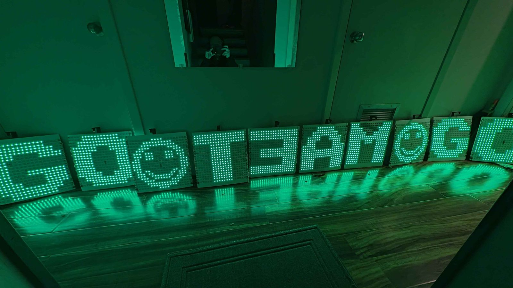
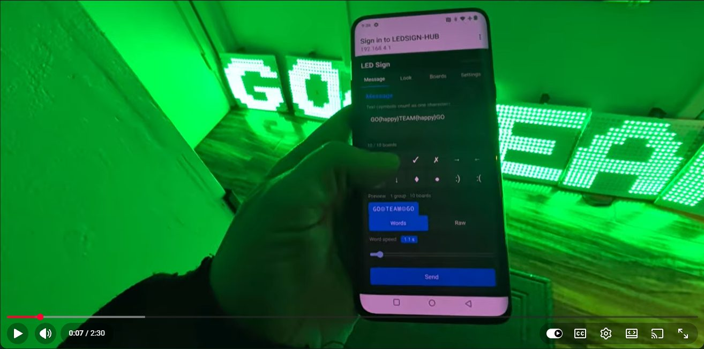
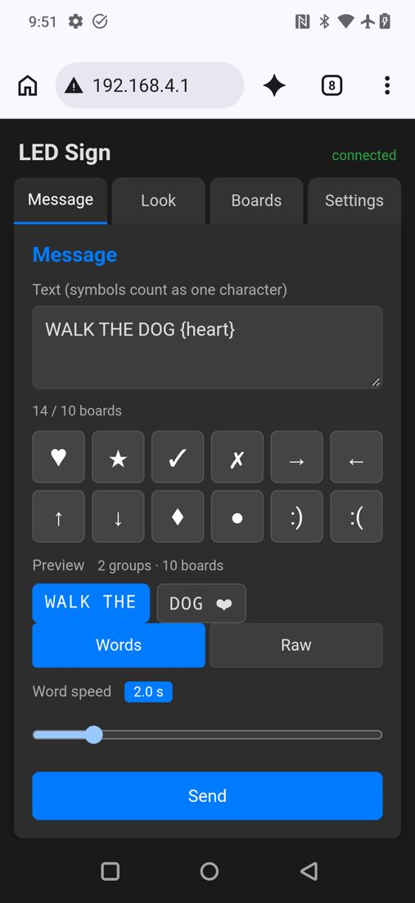
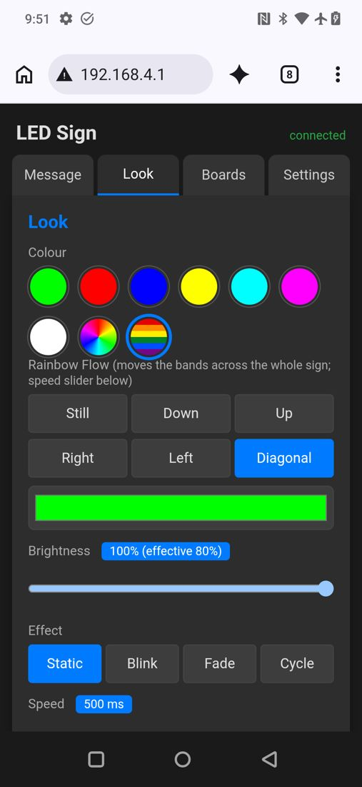
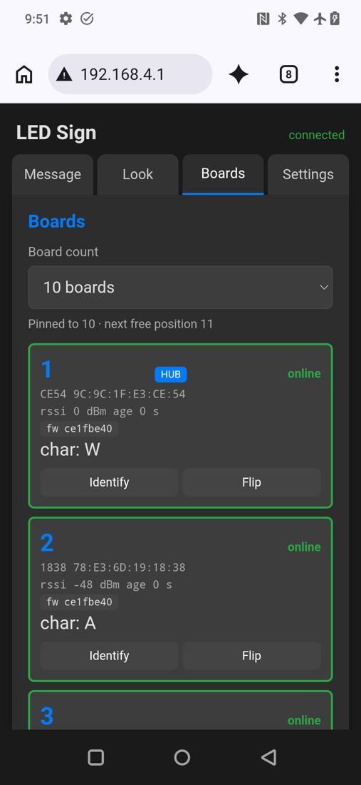
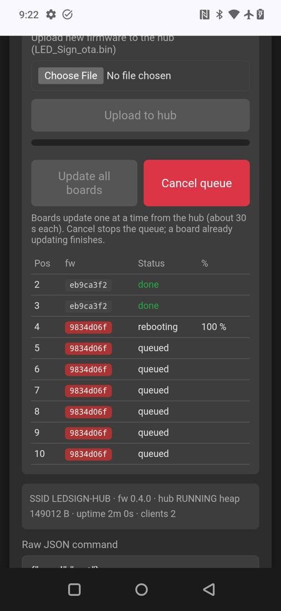

# ESP32 LED Sign — wireless multi-board WS2812B sign

Battery-powered 20×20 LED boards, each with its own ESP32, that work together as one sign with **no cables between boards**. One board is the hub: phones join its Wi-Fi and control the whole sign from a web page; the hub drives the other boards over ESP-NOW. Built and tested with **10 boards**.



[](https://www.youtube.com/watch?v=DiyBTvzq21I)

▶ **[Esp32 - led signs - esp-now](https://www.youtube.com/watch?v=DiyBTvzq21I)** (2:30) — narrated walkthrough of the 10-board sign controlled from a phone.

<p>




</p>

**Highlights**
- Phone control via captive portal — no app; works on iPhone and Android.
- Messages with symbols (♥ ★ ✓ ✗ arrows ◆ ● ☺ ☹), automatic word grouping and live preview, word changes synchronised across boards (~8 ms skew).
- Colours, Blink/Fade/Cycle, **Rainbow Bands** (stripes line up across the sign) and **Rainbow Flow** (bands move Down/Up/Right/Left/Diagonal across the whole sign).
- Plug-and-play board numbering by power-on order, remembered across restarts; Identify, Flip (mirrored boards), live per-board status.
- **Over-the-air updates**: upload to the hub from the phone, then "Update all boards" — 10 boards in ~3 minutes, with automatic rollback.

**→ Full feature tour with screenshots: [`docs/FEATURES.md`](docs/FEATURES.md)**

**→ Build a board (parts with links, matrix, wiring, 3D-printed battery hanger, photos): [`docs/HARDWARE_ASSEMBLY.md`](docs/HARDWARE_ASSEMBLY.md)**

Engineering docs: [`docs/PROJECT_PLAN.md`](docs/PROJECT_PLAN.md) (architecture, protocol) · [`Progress.md`](Progress.md) (log, decisions) · `docs/reviews/` (verification reports).

## Layout
```
README.md                 this file
Progress.md               status log, decisions, open questions
docs/
  FEATURES.md             feature tour with screenshots
  images/                 photos and phone UI screenshots (hardware/ = build photos)
  HARDWARE_ASSEMBLY.md    build one board: parts, matrix, wiring, battery hanger
  PROJECT_PLAN.md         the plan (review this first)
  research/               ESP-NOW feasibility + mobile app research reports (with sources)
  HARDWARE_README_v3.md   original single-ESP32 project guide (legacy; parts/battery info still useful)
  LIFEPO4_PERFECT_SOLUTION.md, XL4015_SETUP_GUIDE.md, CAPACITOR_GUIDE.md, BATTERY_HOLDER_PRINT_GUIDE.md
firmware/
  legacy/                 current single-board v4 (4-button) firmware and the old WiFi web-UI firmware
  LED_Sign_Mesh/          mesh firmware (hub + node, one binary; Phase 4 OTA)
hardware/
  battery_hanger_-_led_sign_v4.stl   battery hanger (print this)
  battery_hanger_-_led_sign_v3.f3d   Fusion 360 source
```

## Which board is the hub?
A **dedicated board**, not whichever powers on first. The hub role is a flag saved in that board's flash (NVS); every other board, including freshly flashed ones, defaults to **node**. Label the hub sign ("HUB / 1").

- Current hub: MAC `9C:9C:1F:E3:CE:54`. It is always position **1** and runs the `LEDSIGN-HUB` Wi-Fi that phones join.
- Power-on order only numbers the **nodes**: first node powered after the hub gets 2, the next 3, … Positions stick by MAC until cleared (hub K3 long-press ≥ 3 s, or **Reset order** in the Boards tab), then power the boards on again in the order you want.
- To make a different board the hub: hold **K4 while applying power** (~3 s) → it shows "H" and saves the role; flip the old hub back the same way (shows "N"). Boards without buttons: send `H`/`N` over serial in the first 3 s after reset. Only one hub should be powered at a time.
## Firmware: wired install once, then over the air forever
Build: `esp32:esp32:lolin32:PartitionScheme=min_spiffs` (two 1.9 MB app slots for OTA). One source tree builds one program; the **role is pre-seeded in the settings partition** of the install images so a board is a hub or a node from its very first boot. `tools/make_images.sh` (build box) writes `build_id.h`, compiles, and puts the images in `release/<commit>/` with a README and SHA256SUMS:

| file | goes to | how | effect |
|---|---|---|---|
| `LED_Sign_HUB_install.bin` | **the one hub board** | USB, offset `0x0` | full install, role = HUB, settings wiped |
| `LED_Sign_NODE_install.bin` | every other board | USB, offset `0x0` | full install, role = NODE, settings wiped |
| `LED_Sign_ota.bin` | the hub, from the phone | Wi-Fi upload | update — keeps role, positions, message |

**Install (once per board, and once more for every board when moving to the Phase 4 partition layout):** `python tools/flasher.py` (guided) or `tools/flash_board.sh /dev/ttyUSBx hub|node` on the build box. Windows: `esptool --chip esp32 --port COMx --baud 115200 write-flash -z 0x0 <file>`. Never flash the HUB image onto more than one powered board. **Keep the board plugged in until the flash reports "Hash of data verified".**

**Update (every release after that):** join the sign's Wi-Fi → Settings → **Firmware** → choose `release/<commit>/LED_Sign_ota.bin` → **Upload to hub**. The hub reboots into the new image (~20 s). Then press **Update all boards**: the hub updates every node whose build differs from its own, one at a time (~20 s each; the board shows its number in blue with a green progress bar). From a computer on the sign's Wi-Fi: `curl -F "file=@LED_Sign_ota.bin" http://192.168.4.1/ota`, then `curl -d '{"cmd":"ota_nodes"}' http://192.168.4.1/cmd`. Serial on the hub: `o` = update all, `O5` = update board 5, `s` shows build / slot / queue.

**Rollback:** a freshly updated board must run healthy for 30 s (hub: running with its Wi-Fi up; node: on the radio channel and joined/discovering) before the new image is confirmed. If it resets before that — crash, watchdog, or a power cycle — the bootloader starts the previous image on that **one** reset. A failed node download never touches the running image. There is no wired "app-only update" image any more (with two app slots an app-only write at `0x10000` can hit the wrong slot).

**Mirrored board** (letters appear backwards because the LED data line enters from the other side): Boards tab → that board's card → **Flip**. Or hold **K1 while applying power** (shows "E"), or serial `m`. The flag is saved on that board. Re-numbering after a NODE install: the hub remembers the board's MAC, so it gets its old position back unless you reset the order.

## Status and roadmap
**Working today (10 real boards):** phone control over the hub's Wi-Fi, ESP-NOW to every board, plug-and-play numbering, word sequencing, symbols, effects, Rainbow Bands / Rainbow Flow, Identify / Flip, and over-the-air updates with rollback. Build log and decisions: [`Progress.md`](Progress.md).

**Possible next steps** (none started):
- **More than 10 boards** — 11–20 is a small change (see "How many boards?" in [`docs/FEATURES.md`](docs/FEATURES.md)); beyond 20 needs a design change.
- **Reorder / swap boards from the phone** instead of Reset order + re-powering.
- Minor: OTA polish items D2/D3, the phone `clients` count over-reporting.
- Optional: Bluetooth (BLE) control as an alternative to joining the sign's Wi-Fi (Phase 3 in the plan).
