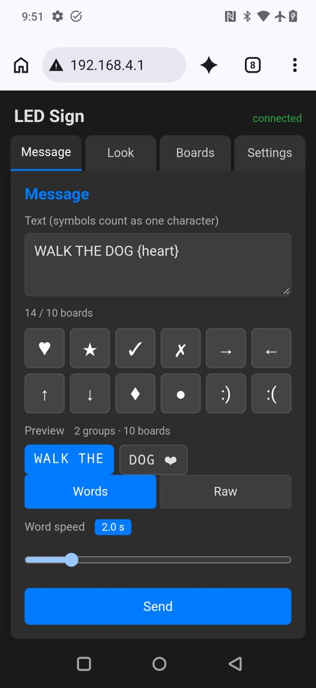
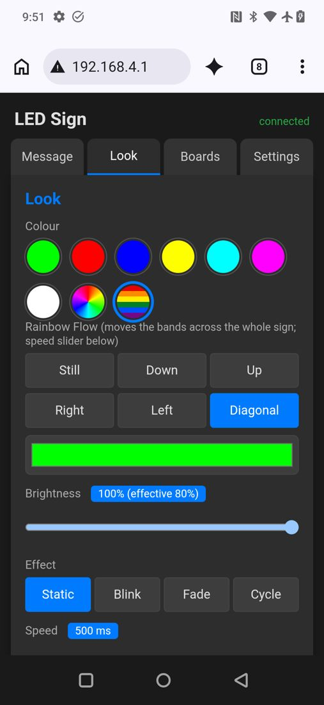
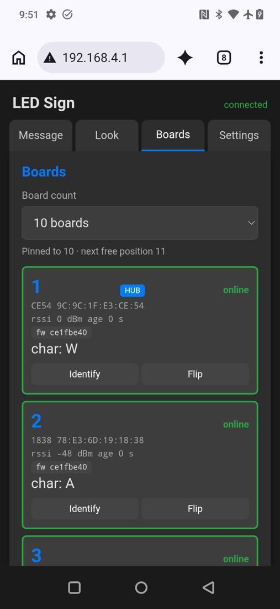
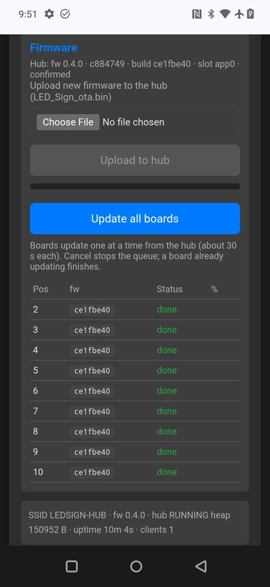
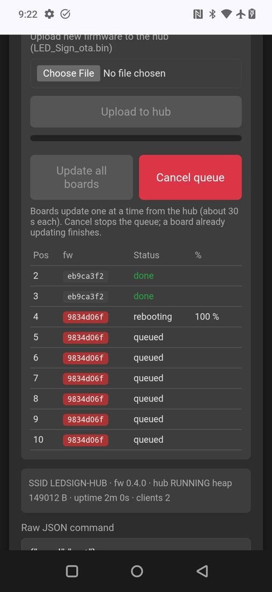

# ESP32 LED Sign — Features

A wireless, battery-powered, multi-board LED sign. Each board is a 20×20 WS2812B matrix (400 LEDs) with its own ESP32 (LOLIN32) and its own 6 V LiFePO4 battery — **no data cables between boards**. One board is the **hub**; the others are **nodes**. The hub hosts the phone UI over its own Wi-Fi and drives every node over **ESP-NOW**. Proven on **10 boards**.

All screenshots below are from a real phone (OnePlus 7 Pro, Chrome) connected to the hub's Wi-Fi.

---

## 1. Phone control — no app to install

Join the sign's Wi-Fi (`LEDSIGN-HUB`) and the control page **pops up automatically** (captive portal), or browse to `http://192.168.4.1`. Works on iPhone and Android, several phones at once. The page is served from the hub itself (gzipped, ~11 kB) — no internet needed.

## 2. Messages, symbols and word grouping



- Type any message; tap the keypad to insert **symbols**: ♥ ★ ✓ ✗ → ← ↑ ↓ ◆ ● ☺ ☹ — a symbol counts as **one** board.
- Up to **60 characters/symbols** per message.
- **Words mode** packs whole words onto the boards and cycles through them: `WALK THE DOG ♥` on 10 boards shows **`WALK THE`** → **`DOG ♥`**. Long words are split cleanly across groups.
- **Live preview** chips show exactly how the message will be split, before you press Send, and highlight the group currently on the sign.
- **Word speed** 0.5–10 s. Word changes are **scheduled on the hub's clock**, so all boards switch in the same frame (measured skew ≈ 8 ms).
- **Raw mode**: one character per board, no cycling.
- 68-glyph font: A–Z, 0–9, punctuation `? ! " : & $ # + . , ' - / @ % ( ) =`, and the symbols above.

<br clear="right">

## 3. Look — colours, effects, Rainbow Bands and Rainbow Flow



- **Colours**: presets, full colour picker, and **Rainbow** (whole-sign colour cycle).
- **Rainbow Bands**: every letter is striped red → orange → yellow → green → blue → purple, and the stripes **line up across all boards** like one flag.
- **Rainbow Flow**: the bands **move** — Down, Up, Right, Left or Diagonal — as **one continuous pattern across the whole sign** (Right travels from board 1 to board 10), synchronised to the hub's clock.
- **Effects**: Static, Blink, Fade, Cycle, all phase-locked across boards; one **Speed** slider for effects and flow.
- **Brightness** with an automatic current cap for multi-colour looks (white 60 %, bands 80 %, rainbow 70 %) to protect batteries and converters.

<br clear="right">

## 4. Boards — automatic numbering and per-board tools



- **Plug-and-play numbering**: power the hub first, then each board in the order you want — it shows its number (2, 3, …) for 3 s and takes that position. Positions are **remembered** across power cycles.
- **Reset order** to re-number by power-on order at a new event.
- Live card per board: position, MAC, signal strength, firmware, and what it is showing (`char: ☺`).
- **Identify**: the board (or all boards) shows its position number in purple for 10 s.
- **Flip**: fixes a board whose LED data line enters from the opposite side (mirrored letters) — no rewiring.
- Board count: auto (highest online) or pinned.
- **Self-healing**: if a board drops out it keeps its last letter (red corner dot) and rejoins automatically; if the hub is replaced or reinstalled, running boards re-register themselves at their saved positions.

<br clear="right">

## 5. Firmware updates over the air




- **Settings → Firmware → choose `LED_Sign_ota.bin` → Upload to hub** (~13 s from a phone).
- **Update all boards**: the hub updates every node **one at a time** from its own copy, with a live progress table (queued → updating % → rebooting → done). ~20 s per board — **all 10 boards in about 3 minutes**.
- **Safe by design**: two firmware slots per board; a new image must run healthy for 30 s or the board **rolls back** automatically; a board that loses power mid-update keeps its old firmware and rejoins.
- Firmware badges turn **red** for any board that differs from the hub.

<br clear="right">

## 6. Settings that survive everything

Message, colour, effects, word speed, board count, Wi-Fi name, roles, positions and per-board flip are stored in flash and survive power cycles and firmware updates (with automatic settings migration between versions).

---

## Hardware (per board)

| Part | Role |
|---|---|
| LOLIN32 (ESP32-WROOM-32) | controller, Wi-Fi + ESP-NOW |
| 20×20 WS2812B matrix (400 LEDs) | display |
| 6 V 6 Ah LiFePO4 with BMS + USB charging | power, ~80 min at 25 % brightness |
| XL4015 buck converter → 5 V | LED + ESP32 supply |
| 10 000 µF capacitor | inrush / colour-change stability |
| Optional 4-button board | standalone control, role/mirror gestures |

See `docs/HARDWARE_README_v3.md` for wiring, parts list and the 3D-printed battery mount.

## How it works

```
 Phone(s) ──Wi-Fi──► HUB (pos 1)  ── ESP-NOW broadcast, channel 6 ──►  NODE 2 … NODE N
           captive    web UI + JSON API         2 Hz "Show" frame:            render their own
           portal     sequencer + clock         text, colour, effect,         character, phase-
                      firmware server :8080     hub clock, apply time         locked to the hub
```

- One firmware image for every board; the role (hub/node) is stored on the board.
- One 40-byte broadcast carries the whole sign state; missed frames heal within 500 ms.
- Details: `docs/PROJECT_PLAN.md`, verification reports in `docs/reviews/`.

## How many boards?

| | Now | Change needed |
|---|---|---|
| **Up to 10** | ✅ built and tested (10 real boards) | — |
| **11–20** | possible | raise `MAX_BOARDS` to 20; add two-digit position glyphs 11–20; UI board-count list; settings-table migration. The broadcast frame grows from 40 to 50 bytes but stays compatible (older boards read the first 10). |
| **More than 20** | design change | ESP-NOW allows **20 peers** per ESP32 (hub + 19 nodes). Beyond that the hub must rotate peers or use broadcast-only status. The broadcast frame itself has room for ~200 positions. |

Practical notes for bigger signs: over-the-air update time grows linearly (~20 s per board, so 20 boards ≈ 7 min); each board has its own battery, so power scales without new wiring; keep the hub roughly central for radio range.

## Firmware images (per release, `release/<git>/`)

| File | Use |
|---|---|
| `LED_Sign_HUB_install.bin` | first-time USB install of the one hub board (offset `0x0`) |
| `LED_Sign_NODE_install.bin` | first-time USB install of every other board (offset `0x0`) |
| `LED_Sign_ota.bin` | every update after that — upload from the phone |

USB installs use `tools/flasher.py` (guided: hub first, then add-on boards) or `esptool --chip esp32 --baud 115200 write-flash -z 0x0 <file>`.
