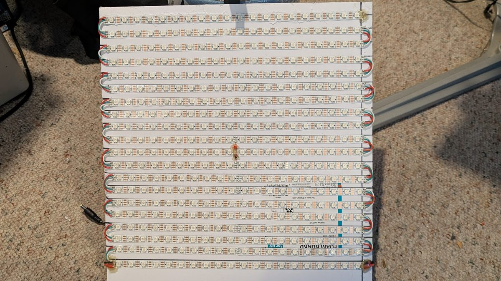
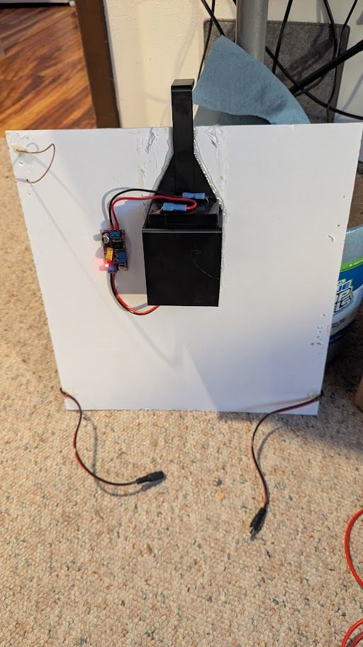
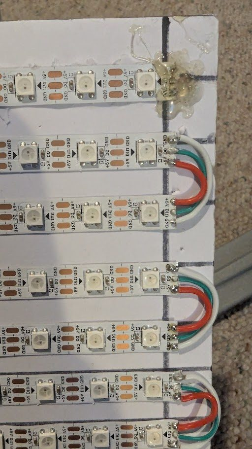
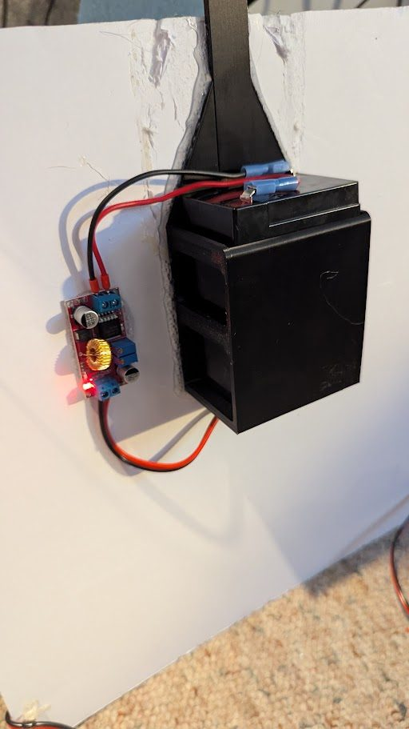
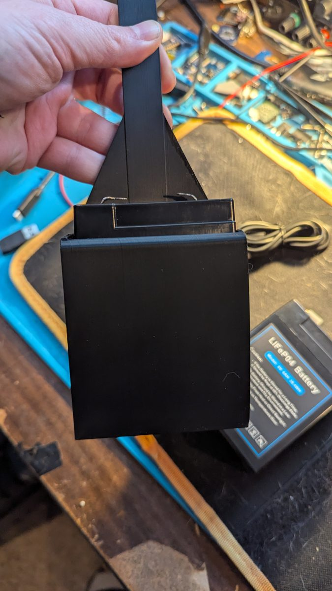
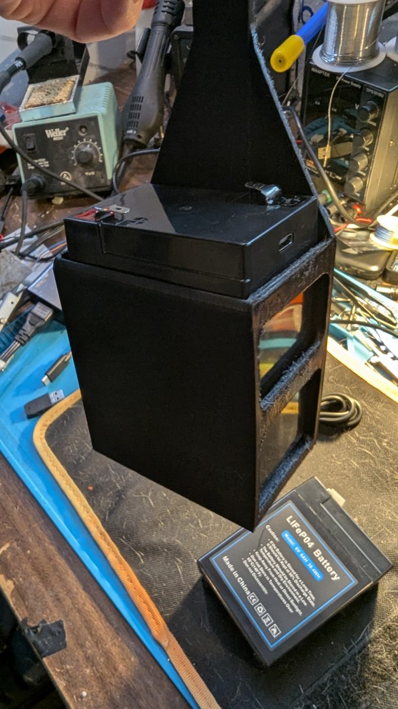

# Hardware assembly — one board

Every board in the sign is built the same way and stands alone: a 20×20 WS2812B matrix on foam board, its own LOLIN32, its own LiFePO4 battery and its own 5 V buck converter. There are **no cables between boards**, and the hub is an ordinary board that gets the HUB firmware image. Build one board, test it, then repeat for as many boards as you want (10 tested).

Ported from the original single-controller project ([Alternating/8board-esp32-ledproject](https://github.com/Alternating/8board-esp32-ledproject)) and adapted to this design. That project ran 5–8 matrices from one ESP32 with one data wire per board; that wiring (and its GPIO 5/16/17/… pin table) does **not** apply here.

<p>


</p>

---

## 1. Parts per board

| Part | Qty / board | Notes | Product used |
|---|---|---|---|
| **LOLIN32** (ESP32-WROOM-32) | 1 | controller; one firmware for hub and nodes | LOLIN32 / Wemos LOLIN32 board |
| **WS2812B 5 V strip, 60 LED/m** | 400 LEDs (20 × 20) | 5 V version, WS2812B, white PCB | [Amazon — WS2812B](https://www.amazon.com/dp/B01CDTEJBG) (custom 10 m reels direct from BTF-Lighting) |
| **LiFePO4 6 V 6 Ah**, BMS + USB charging, F1 terminals | 1 | one battery per board | [Amazon — LiFePO4 2-pack](https://www.amazon.com/dp/B0D6YJ1RK6) |
| **XL4015 buck converter** (5 A, adjustable) | 1 | set to 5.0 V **before** connecting anything | [Amazon — XL4015 10-pack](https://www.amazon.com/dp/B0D9JQBQYJ) |
| **10 000 µF 25 V electrolytic capacitor** | 1 | across the 5 V output — stops brown-outs on big colour changes | any 10 000 µF ≥ 16 V |
| **470 Ω resistor** | 1 | in series with the LED data line | — |
| **F1 female spade lugs** (0.187″) | 2 | battery terminals | [BatterySpec — F1 connectors](https://www.batteryspec.com/cgi-bin/cart.cgi?action=link&product=1045) |
| **DC barrel pigtails** 2.1 × 5.5 mm, 18 AWG | 1 pair | unplug the matrix from the power side | [Amazon — DC pigtail 10-pack](https://www.amazon.com/dp/B072BXB2Y8) |
| **22 AWG silicone wire** | — | row jumpers, data, ESP32 power | [Amazon — 22 AWG kit](https://www.amazon.com/dp/B0BWGXH5SF) |
| **Dupont connectors** | — | ESP32 header connections | [Amazon — Dupont kit](https://www.amazon.com/IWISS-1550PCS-Connector-Headers-Balancer/dp/B08X6C7PZM/) |
| **White foam board** 20″ × 30″ | 1 sheet | matrix backing | [Walmart — foam board](https://www.walmart.com/ip/Pen-Gear-White-Foam-Board-20-x-30/5347546821) |
| **3D-printed battery hanger** | 1 | `hardware/battery_hanger_-_led_sign_v4.stl` | PLA or PETG, ~50 g |
| 4-button board (K1–K4) | optional | standalone control and power-on gestures | — |

**Strip length:** 400 LEDs at 60 LED/m is **6.7 m per board**, so one 6 m reel (360 LEDs) is not quite enough for one board — use a custom-length reel or plan offcuts across boards. A 10-board sign needs 4 000 LEDs (~67 m).

**Must-haves** (from the original build): 5 V strips (not 12 V), WS2812B chipset, a battery with a built-in BMS, the XL4015 (not an LM2596), and 18 AWG for the 5 V power run.

---

## 2. Build the matrix



1. **Mark the panel.** Cut a square panel from the foam board and rule 20 evenly spaced horizontal lines for the rows, plus a vertical line at each end so every row starts and stops at the same column.
2. **Cut 20 strips of 20 LEDs.** Cut only across the copper pads between LEDs.
3. **Stick the rows down, alternating direction** (serpentine). Watch the printed arrows: row 1 runs one way, row 2 the opposite way, and so on, so the data arrow zig-zags down the board.
4. **Join row ends with short U-jumpers** — three wires each: +5 V to +5 V, DO to DIN, GND to GND (photo). Tin the pads first, keep jumpers short, and add a dab of hot glue over the joints for strain relief.
5. **Data input at the top corner.** The firmware expects LED 0 in the **top row** with rows snaking downwards. A normal board has its data input at the **top-right corner as seen from the front**. If you wire it from the top-left instead, letters come out mirrored — no rewiring needed: set **Flip** for that board in the phone UI (Boards tab).
6. **Power:** bring +5 V/GND from the power side to the matrix through the barrel pigtail. A full-white board can draw ~24 A at 100 %, which is why the firmware caps brightness (white 60 %, rainbow 70 %, colours/bands 80 %).

<br clear="right">

---

## 3. Wire the power and controller



```
 LiFePO4 6 V ──F1 lugs──► XL4015  IN+ / IN−
                          OUT+ (5.0 V) ──┬── 10 000 µF (+) ──┬── LED matrix +5 V
                                         │                   └── LOLIN32 5 V
                          OUT− ──────────┴── 10 000 µF (−) ──┬── LED matrix GND
                                                             └── LOLIN32 GND   (common ground!)

 LOLIN32 GPIO 4 ──[470 Ω]──► LED DIN (first LED, top-right from the front)

 optional buttons (to GND, internal pull-ups):
   K1 GPIO 17   K2 GPIO 16   K3 GPIO 18   K4 GPIO 19
 LOLIN32 on-board status LED: GPIO 5
```

**Set the XL4015 first** (full procedure: [`XL4015_SETUP_GUIDE.md`](XL4015_SETUP_GUIDE.md)):
1. Charge the battery (USB; red = charging, green = full).
2. Connect battery → XL4015 input **only**.
3. With a multimeter on OUT+/OUT−, turn the trim pot until it reads **5.0 V** (±0.05 V). Mark the pot.
4. Now connect the capacitor (mind polarity), the matrix and the LOLIN32.
5. First power-up at low brightness; the XL4015 should be warm, not hot.

**All grounds must be common**: battery −, XL4015 OUT−, capacitor −, matrix GND and LOLIN32 GND. A missing ESP32 ground is the usual cause of random flicker.

Capacitor details and placement: [`CAPACITOR_GUIDE.md`](CAPACITOR_GUIDE.md).

<br clear="right">

---

## 4. Print and mount the battery hanger

<p>


</p>

- **Files:** [`hardware/battery_hanger_-_led_sign_v4.stl`](../hardware/battery_hanger_-_led_sign_v4.stl) (print this) and [`hardware/battery_hanger_-_led_sign_v3.f3d`](../hardware/battery_hanger_-_led_sign_v3.f3d) (Fusion 360 source, for modifications).
- **Print:** PLA or PETG, 0.2 mm layers, 20–30 % infill, supports as your slicer suggests; ~3–4 h, ~50 g.
- The hanger's strap passes through a notch cut in the top edge of the foam board, so the board hangs from it with the battery on the back (photos at the top and in section 3).

Print settings, fit troubleshooting and modifications: [`BATTERY_HOLDER_PRINT_GUIDE.md`](BATTERY_HOLDER_PRINT_GUIDE.md).

---

## 5. Flash and test

1. Flash the board over USB once: **`LED_Sign_HUB_install.bin`** for the one hub board, **`LED_Sign_NODE_install.bin`** for every other board (`python tools/flasher.py`, or `esptool --chip esp32 --baud 115200 write-flash -z 0x0 <file>`). See the README's firmware section.
2. Label the hub board ("HUB / 1").
3. Power the hub, then each node in the order you want: each shows its number for 3 s and keeps it.
4. Join `LEDSIGN-HUB` (password `sign1234`) on a phone; the control page opens automatically.
5. If a board's letters are backwards, tap **Flip** on its card. All later firmware updates go over the air.

---

## 6. Battery and runtime

- One 6 V 6 Ah battery (36 Wh) per board. The original build measured ~25 W for a board with **all** LEDs at 25 % — about **80 min**; text lights only part of the board, so real runtime is usually longer. Every board has its own battery, so adding boards does not shorten runtime.
- Recharge at ~6.0 V (≈30 %); the BMS cuts off near 5.5 V. Store long-term at ~60 %.
- Charge over USB with any 5 V adapter (2 A ≈ 3–4 h).

Battery chemistry, charging and care: [`LIFEPO4_PERFECT_SOLUTION.md`](LIFEPO4_PERFECT_SOLUTION.md). The full original hardware guide (cost breakdown, buying tips, alternatives) is kept as [`HARDWARE_README_v3.md`](HARDWARE_README_v3.md) — its pin table, multi-board wiring and software sections are for the old single-ESP32 design.

---

## Troubleshooting

| Symptom | Check |
|---|---|
| Nothing lights | XL4015 output really 5.0 V; data on GPIO 4 through 470 Ω into **DIN** (not DO); common ground |
| First rows fine, the rest dark or garbage | a row jumper with DO/DIN crossed or a cold joint at the last good row |
| Random flicker | ESP32 GND not tied to LED GND; missing 10 000 µF capacitor; low battery |
| Board resets on colour changes | capacitor missing or wrong polarity; battery near cut-off |
| Letters mirrored | data enters from the other side — **Flip** in the Boards tab |
| Wrong colours | strip is not GRB WS2812B (firmware uses GRB) |
